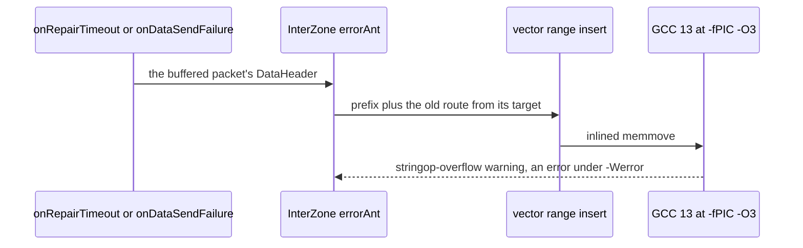
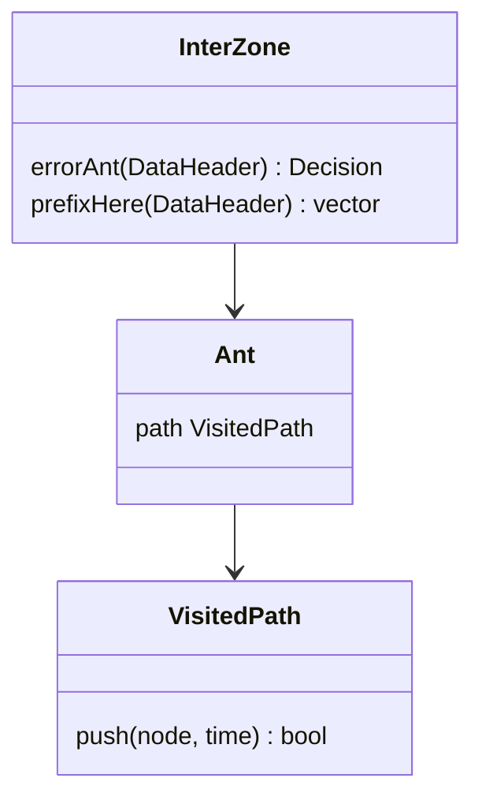

# HOP-001: core/ fails a GCC 13 Release -fPIC build (-Wstringop-overflow in InterZone::errorAnt)

## Summary

| | |
|---|---|
| ID | HOP-001 |
| RCAPA ticket | [swarm-routing/HOPNET#232](https://github.com/swarm-routing/HOPNET/issues/232): `[rcapa] HOP-001 core/ fails GCC 13 Release -fPIC build: -Wstringop-overflow in InterZone::errorAnt` |
| Status | open (fix on its pull request) |
| Releases | fails: v0.2.0 (GitHub release; the `hopnet-core` 0.2.0 vcpkg port, not yet published); last good: none ported (v0.1.0 has no port) |
| Found | 2026-11-25, in [swarm-routing/vcpkg-registry#80](https://github.com/swarm-routing/vcpkg-registry/pull/80) |
| Last checked | 2026-11-25 (local reproduction, GCC 13.3.0, against `v0.2.0` and the fix) |
| Impact | the `hopnet-core` 0.2.0 port cannot be installed on x64-linux with GCC 13, so it cannot be published; the ns-3 module and the published numbers are unaffected (no behaviour change) |
| Fixed in | the pull request for [swarm-routing/HOPNET#232](https://github.com/swarm-routing/HOPNET/issues/232); release: not yet |

`InterZone::errorAnt` built the error ant's Path by concatenating two
vectors with `vector::insert`. Under the port's `-fPIC -O3`, GCC 13 reports a
`-Wstringop-overflow` false positive in the inlined range insert, and the core's
`-Werror` fails the build. The fix pushes both halves straight into the
ant's `VisitedPath`: same Path, same order, same drop past the cap.

## Problem and detection

The registry's `install (x64-linux)` job on swarm-routing/vcpkg-registry#80
(the `hopnet-core` 0.2.0 port) failed:

```
core/hopnet-repair.cc:251 in InterZone::errorAnt: std::copy -> __builtin_memmove
error: 'void* __builtin_memmove(void*, const void*, long unsigned int)' writing between 5 and 9223372036854775804 bytes into a region of size 0 overflows the destination [-Werror=stringop-overflow=]
```

## Reproduction

```bash
git clone --depth 1 --branch v2.0.0 https://github.com/swarm-routing/swarm-core ../swarm-core   # swarm-core.lock's release
git checkout v0.2.0
cmake -S core -B build/ci -DCMAKE_BUILD_TYPE=Release -DCMAKE_CXX_FLAGS=-fPIC -DSWARM_CORE_DIR=../swarm-core/core
cmake --build build/ci
```

- Release / commit: HOPNET `v0.2.0` (`core/hopnet-repair.cc` unchanged on `main` at `3ee218d`); swarm-core v2.0.0 `5fb7c180`; GCC 13.3.0 (Ubuntu 24.04)
- Expected: the build passes and ctest is green.
- Actual: `-Werror=stringop-overflow=` at `hopnet-repair.cc:251`. `-fPIC -O2` fails as well; `-O3` without `-fPIC`, and Debug, pass.

## Root cause: five whys

1. **Why does the build fail?** `-Werror` (`core/CMakeLists.txt`, `HOPNET_WARNINGS`) turns GCC 13's `-Wstringop-overflow` into an error (evidence: the log above).
2. **Why does GCC warn?** `errorAnt` called `path.insert(path.end(), header.route.begin() + target, header.route.end())` (`core/hopnet-repair.cc:251` at `v0.2.0`); with `-fPIC -O2/-O3` libstdc++'s `_M_range_insert` is inlined and GCC's range analysis sees a branch that writes into a zero-size region (evidence: local reproduction; the warning goes when the insert goes).
3. **Is the write real?** No: `prefix.size() >= 2` and `0 <= target < route.size()` are checked just before, and the old and new code build the same Path (evidence: `core/test/test-repair.cc` passes on both, including the new cap test). It is a false positive of the optimiser on a valid range insert.
4. **Why only with `-fPIC`?** Position-independent code changes GCC's inlining and interposition decisions, so the range insert is inlined into `errorAnt` only then (evidence: `-O3` alone passes, `-fPIC -O3` fails; a hypothesis for the mechanism, the flag dependence is observed).
5. **Why did our checks let it into a release?** `core.yml` built Debug (ctest, ASan + UBSan) and a Release package step without `-fPIC`; no leg built the port's flag set, and no port consumer existed before v0.2.0.

## Diagrams

### Failing call chain



### Components involved



## Corrective actions

| Action | Where | Status |
|--------|-------|--------|
| Build the error ant's Path without the concatenated copy | the pull request for [swarm-routing/HOPNET#232](https://github.com/swarm-routing/HOPNET/issues/232) | open |
| A release carrying the fix, and the port bump in the registry | [swarm-routing/vcpkg-registry#80](https://github.com/swarm-routing/vcpkg-registry/pull/80) or its successor | open |

## Preventive actions

| Action | Where | Status |
|--------|-------|--------|
| `core.yml`: a Release + `-fPIC` build and ctest with strict warnings, the port's flag set (fails on `v0.2.0`, passes on the fix) | the pull request for [swarm-routing/HOPNET#232](https://github.com/swarm-routing/HOPNET/issues/232) | open |
| A core test pinning the error ant's Path at and past the cap | `core/test/test-repair.cc`, same pull request | open |

## Timeline

| Date | Event |
|------|-------|
| 2026-11-25 | swarm-routing/vcpkg-registry#80 fails `install (x64-linux)`; reproduced locally; ticket swarm-routing/HOPNET#232 opened; fix and Release CI leg proposed |

## Links

- [swarm-routing/vcpkg-registry#80](https://github.com/swarm-routing/vcpkg-registry/pull/80)
- [swarm-routing/HOPNET#232](https://github.com/swarm-routing/HOPNET/issues/232)
