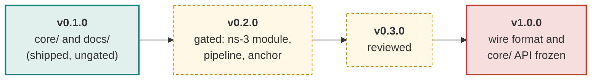
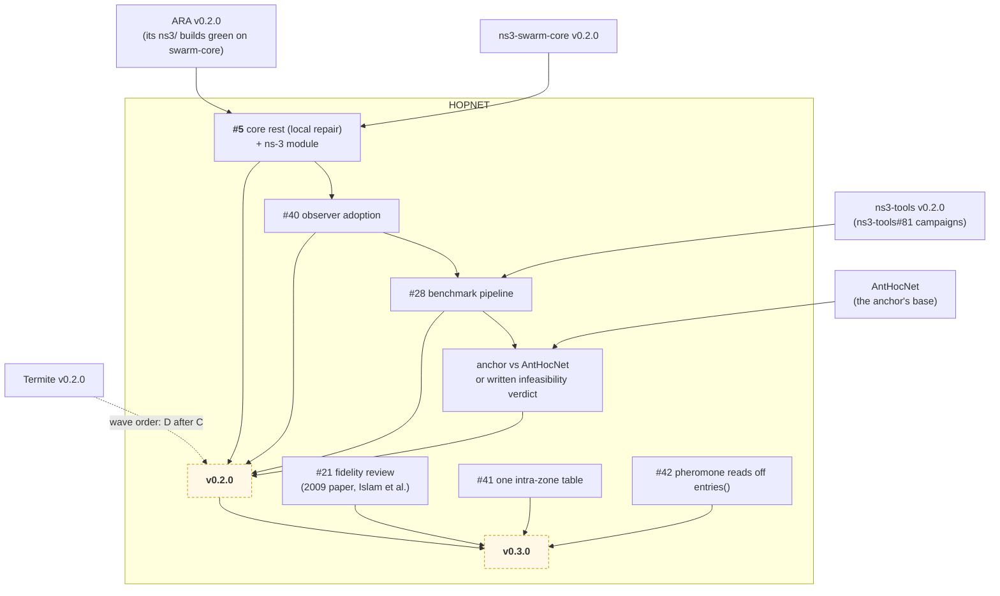

# Roadmap

HOPNET's release ladder in one page. The org adopted the ladder on 2026-11-11
(maintainer decision: "adopt the release ladder and replace the phase-targets
rule"); the shape is AntHocNet's
[`docs/roadmap.md`](https://github.com/swarm-routing/AntHocNet/blob/main/docs/roadmap.md).
The cross-repo release train (waves A to E) is in the
[org ROADMAP](https://github.com/swarm-routing/.github/blob/main/ROADMAP.md);
HOPNET is in wave D. Issue state is always truer than a checked-in diagram.

## How this plan is tracked

Each issue a release gates carries one **`release:` label**, so every row below
is a live query:

| Release | Board |
|---|---|
| v0.2.0 | [`release:v0.2.0`](https://github.com/swarm-routing/HOPNET/issues?q=is%3Aopen+label%3A%22release%3Av0.2.0%22) |
| v0.3.0 | [`release:v0.3.0`](https://github.com/swarm-routing/HOPNET/issues?q=is%3Aopen+label%3A%22release%3Av0.3.0%22) |
| v1.0.0 | [`release:v1.0.0`](https://github.com/swarm-routing/HOPNET/issues?q=is%3Aopen+label%3A%22release%3Av1.0.0%22) |
| all epics | [`epic`](https://github.com/swarm-routing/HOPNET/issues?q=is%3Aopen+label%3Aepic) |

Only issues a release actually gates are labelled; unscheduled work lands when
it lands. Majors are reserved for breaking changes, and 1.0.0 is the stability
promise.

## Release ladder

Green is shipped (v0.1.0, 2026-11-11: it ships `core/` and `docs/` and has
**not** cleared the comparator gates of org golden rule 6, so no number from it
counts as a benchmark result). Amber is planned.

## What blocks what

Solid arrows are hard dependencies; dashed are "informs". Nodes in other
repositories use the cross-repo form.

The ns-3 module waits until ARA's builds green against swarm-core
(maintainer decision 2026-11-10, #3). The pipeline needs `ns3-campaign`
(ns3-tools#81, open), and the anchor pairs HOPNET with AntHocNet through
ns3-tools.

## What each release must show to ship

| Release | Exit criteria |
|---|---|
| **v0.1.0** (shipped 2026-11-11) | `core/` (intra-zone and inter-zone halves) and `docs/fidelity.md`, released ungated by the maintainer's decision of 2026-11-10. |
| **v0.2.0** "gated" | The ns-3 module `hopnet` is green on `ns3-dev:latest-{debug,sanitized}`; the swarm-core router observer is adopted ([#40](https://github.com/swarm-routing/HOPNET/issues/40)); the repository has its own benchmark pipeline, paired smoke and anchor campaigns on the org reusable cell workflow ([#28](https://github.com/swarm-routing/HOPNET/issues/28)); the anchor against AntHocNet gives a verdict, PASS or a written infeasibility verdict (org golden rule 6; this repo's rule 12); the fidelity open items are settled. Scope: the rest of [#5](https://github.com/swarm-routing/HOPNET/issues/5) (§4.3 local repair, ns-3 module), #40, #28. |
| **v0.3.0** "reviewed" | The fidelity sheet is checked against the 2009 journal paper and Islam et al. ([#21](https://github.com/swarm-routing/HOPNET/issues/21)); the perf follow-ups land ([#41](https://github.com/swarm-routing/HOPNET/issues/41), [#42](https://github.com/swarm-routing/HOPNET/issues/42)); any new mechanism is default-off with its own A/B. |
| **v1.0.0** | Wire format and `core/` API frozen; a released run is recorded in the benchmarks global suite. |

## Infrastructure track

Rides along, is labelled by area, and never gates a release: CI hygiene, org
template refreshes (org-bot), settings as code, and the epic lists.

## Deliberate non-goals

- The thesis's own AntHocNet curves are not reproduced as data; the anchor is
  a paired run against `swarm-routing/AntHocNet` or a written infeasibility
  verdict.
- No 1.0.0 before v0.3.0 has been reviewed.

## See also

- [`fidelity.md`](fidelity.md): the thesis, section by section.
- [org ROADMAP](https://github.com/swarm-routing/.github/blob/main/ROADMAP.md): the release train.
- [CONTRIBUTING](https://github.com/swarm-routing/.github/blob/main/CONTRIBUTING.md): invariants, labels, issue shape.
- [AntHocNet roadmap](https://github.com/swarm-routing/AntHocNet/blob/main/docs/roadmap.md): the model for this page.
