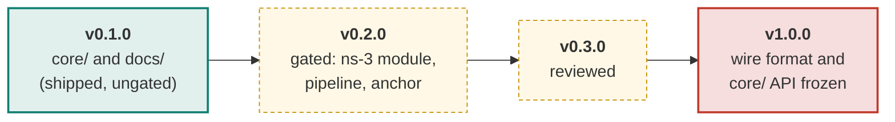
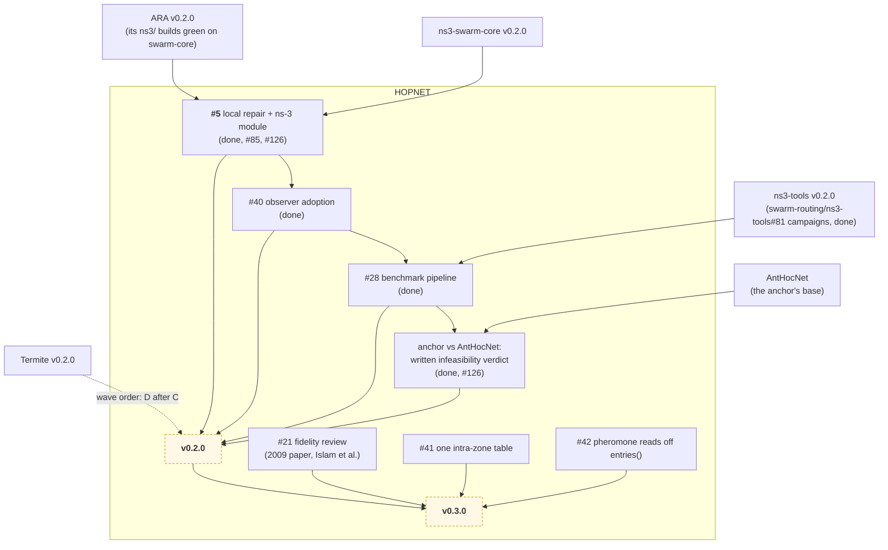

# Roadmap

HOPNET's release ladder in one page. The org adopted the ladder on 2026-11-11
(maintainer decision: "adopt the release ladder and replace the phase-targets
rule"); the shape is AntHocNet's
[`docs/roadmap.md`](https://github.com/swarm-routing/AntHocNet/blob/main/docs/roadmap.md).
The cross-repo release train (waves A to E) is in the
[org ROADMAP](https://github.com/swarm-routing/.github/blob/main/ROADMAP.md);
HOPNET is in wave D. Issue state is always truer than a checked-in diagram.

## How this plan is tracked

Each issue a release gates carries one **`release:` label**, so every row
below is a live query:

| Release | Board |
|---|---|
| v0.2.0 | [`release:v0.2.0`](https://github.com/swarm-routing/HOPNET/issues?q=is%3Aopen+label%3A%22release%3Av0.2.0%22) |
| v0.3.0 | [`release:v0.3.0`](https://github.com/swarm-routing/HOPNET/issues?q=is%3Aopen+label%3A%22release%3Av0.3.0%22) |
| v1.0.0 | [`release:v1.0.0`](https://github.com/swarm-routing/HOPNET/issues?q=is%3Aopen+label%3A%22release%3Av1.0.0%22) |
| all epics | [`epic`](https://github.com/swarm-routing/HOPNET/issues?q=is%3Aopen+label%3Aepic) |

Only issues a release actually gates are labelled; unscheduled work lands when
it lands. Majors are reserved for breaking changes, and 1.0.0 is the stability
promise.

## Release ladder

Green is shipped (v0.1.0, 2026-11-11: it ships `core/` and `docs/` and has
**not** cleared the comparator gates of org golden rule 6, so no number from it
counts as a benchmark result). Amber is planned.

## What blocks what

Solid arrows are hard dependencies; dashed are "informs". Nodes in other
repositories use the cross-repo form.

Done: §4.3's local repair and the ns-3 module (#85; it waited until ARA's
built green against swarm-core, maintainer decision 2026-11-10, #3), the
observer adoption (#40), and `ns3-campaign`, which the pipeline needs
(swarm-routing/ns3-tools#81, closed). The anchor gave its verdict on
2026-11-14: three pre-registered pilot rounds missed threshold A, so it is a
written infeasibility verdict ([`anchor-verdict.md`](anchor-verdict.md),
#126) and the anchor campaign itself was not run. The benchmark pipeline
(#28) closed on 2026-11-24, when its first change-test smoke
(`smoke-47db292`, `tools/bench/campaigns/smoke.yaml`) ran through
`ns3-campaign` and the scripts read it. Nothing blocks v0.2.0; the release
waits for the maintainer.

## What each release must show to ship

| Release | Exit criteria |
|---|---|
| **v0.1.0** (shipped 2026-11-11) | `core/` (intra-zone and inter-zone halves) and `docs/fidelity.md`, released ungated by the maintainer's decision of 2026-11-10. |
| **v0.2.0** "gated" | The ns-3 module `hopnet` is green on `ns3-dev:latest-{debug,sanitized}` (met: `ns3.yml` on `main`); the swarm-core router observer is adopted ([#40](https://github.com/swarm-routing/HOPNET/issues/40), met); the repository has its own benchmark pipeline on the org reusable cell workflow, with a paired change-test smoke dispatched and read by the scripts and the anchor's campaign plans ([#28](https://github.com/swarm-routing/HOPNET/issues/28): met: the workflow, `smoke.yaml` and the pilot plans, and the smoke `smoke-47db292` dispatched and read on 2026-11-24); the anchor against AntHocNet gives a verdict, PASS or a written infeasibility verdict (org golden rule 6; this repo's rule 12; met: the written infeasibility verdict, [`anchor-verdict.md`](anchor-verdict.md), so HOPNET's numbers do not count in comparisons and the release notes say so); the fidelity unknowns that `core/` and the anchor depend on are each a repo choice or a recorded decision in `docs/fidelity.md` (met: zone radius 2 from [W07] p. 36; internal-ant period 2 s, reading (n); AntHocNet at its v2.7.0 release commit with its defaults, maintainer decision 2026-11-13); unknowns only the 2009 paper can settle stay with the v0.3.0 review (#21); the hopnet-core port in swarm-routing/vcpkg-registry is ready (maintainer decision 2026-11-24, #198: every C++ release has a vcpkg port; met before release: `core/` installs as the CMake package hopnet-core, #144, `release.yml` passes `vcpkg-ports: hopnet-core`, and the registry's `tools/port_bump.py` renders the new port from `templates/hopnet-core` against the v0.2.0 dry-run's asset). The port PR itself can only exist after publish, since `release.yml` opens it then from the published asset, so its merge is release aftercare, with the DOI and the site's `[release-sync]` issue, not a gate. Scope (`release:v0.2.0`): [#5](https://github.com/swarm-routing/HOPNET/issues/5) (closed), #40 (closed), #28 (closed). Not in scope: #188 (the org's swarm-core / swarm-adapter-ns3 migration; the module already builds on swarm-adapter-ns3 v2.0.0, and its wire-header item gates v1.0.0's freeze, #75). |
| **v0.3.0** "reviewed" | The fidelity sheet is checked against the 2009 journal paper and Islam et al. ([#21](https://github.com/swarm-routing/HOPNET/issues/21)); the perf follow-ups land ([#41](https://github.com/swarm-routing/HOPNET/issues/41), [#42](https://github.com/swarm-routing/HOPNET/issues/42)); any new mechanism is default-off with its own A/B. |
| **v1.0.0** | Wire format and `core/` API frozen; a released run is recorded in the benchmarks global suite. |

## Infrastructure track

Rides along, is labelled by area, and never gates a release: CI hygiene, org
template refreshes (org-bot), settings as code, and the epic lists.

## Deliberate non-goals

- The thesis's own AntHocNet curves are not reproduced as data; the anchor is
  a paired run against `swarm-routing/AntHocNet` or a written infeasibility
  verdict.
- No 1.0.0 before v0.3.0 has been reviewed.

## See also

- [`fidelity.md`](fidelity.md): the thesis, section by section.
- [org ROADMAP](https://github.com/swarm-routing/.github/blob/main/ROADMAP.md): the release train.
- [CONTRIBUTING](https://github.com/swarm-routing/.github/blob/main/CONTRIBUTING.md): invariants, labels, issue shape.
- [AntHocNet roadmap](https://github.com/swarm-routing/AntHocNet/blob/main/docs/roadmap.md): the model for this page.

## Shipped releases

Every published release with its Zenodo version DOI, read from Zenodo by swarm-routing/.github `tools/zenodo/zenodo.py shipped` (org-bot's `release-aftercare` task); never edit the block by hand.

<!-- releases:shipped:begin (zenodo.py shipped --write; never edit by hand) -->
- **v0.2.0** shipped 2026-11-25 ([release](https://github.com/swarm-routing/HOPNET/releases/tag/v0.2.0), Zenodo version DOI [10.5281/zenodo.24518727](https://doi.org/10.5281/zenodo.24518727))
- **v0.1.0** shipped 2026-11-11 ([release](https://github.com/swarm-routing/HOPNET/releases/tag/v0.1.0), Zenodo version DOI [10.5281/zenodo.24125266](https://doi.org/10.5281/zenodo.24125266))
<!-- releases:shipped:end -->
